

# Eldad Gonsherovitz

### AI Solutions & Agentic Systems Lead

**Business problems → clear requirements → connected AI solutions → human-controlled delivery**

[LinkedIn](https://www.linkedin.com/in/eldad-gonsherovitz-97153846/) · Private project demonstrations available on request

I identify the real problem behind a business request, understand the people, processes and data involved, and turn that understanding into practical AI products and connected workflows. My work combines over 20 years of business and operational leadership — building and running businesses, leading teams, and working with customers, suppliers and service operations — with hands-on AI exploration and AI-assisted building since early 2023.

As a Project Manager at Verifone Israel, I work across customers, business stakeholders and technical teams. In parallel, I conceive and build independent AI products. I bring business discovery, system analysis and technical delivery together: from the first question through requirements, design, development, testing and improvement.

## Explore the portfolio

[JobHunterX](#jobhunterx--human-controlled-ai-career-operations) · [APEX](#apex--agentic-business-intelligence-and-operations) · [ThaiFamily Trip](#thaifamily-trip--ai-assisted-family-travel-planning) · [WatchUp](#watchup--privacy-aware-family-alerts)

[WebtopKids](#webtopkids--school-updates-made-simple) · [Remind Me](#remind-me--voice-first-ai-assistant) · [Voice GmailBot](#voice-gmailbot--ai-workspace-assistant) · [GiftWallet](#giftwallet--smart-gift-card-management)

[PRD Intake](#prd-intake--automation-brief--from-business-need-to-structured-brief) · [ELDO](#eldo--personal-ai-agent-in-development) · [DREAM TEAM](#dream-team--agent-work-overview) · [EG Skills](#eg-skills-core--ai-work-orchestration) · [New Project Tool](#new-project-tool--project-setup-workflows)

## How I work

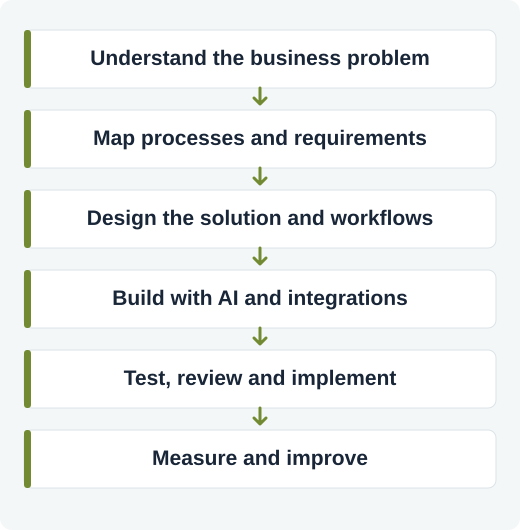

- **Business and systems analysis:** discovery, process mapping, PRDs, requirements, user stories and acceptance criteria.
- **AI and agentic systems:** LLM workflows, specialized agents, orchestration, prompt design, validation and human approval.
- **Integrations and automation:** APIs, SOAP, webhooks, MCP, n8n and connected business workflows.
- **Product and project delivery:** roadmaps, prioritization, stakeholder coordination, implementation and acceptance testing.
- **Quality and improvement:** E2E and regression testing, dashboards, reporting, monitoring and iteration.

## Selected projects

These descriptions show the product problem, approach and relevant technology. Most repositories are private; their summaries intentionally exclude confidential or personal data. Availability, integrations and operational status can change. Demonstrations use approved or synthetic information.

### JobHunterX — Human-controlled AI career operations

Job searching often involves fragmented job sources, repetitive résumé tailoring and scattered follow-up. I conceived and built JobHunterX to bring the process into one controlled workflow.

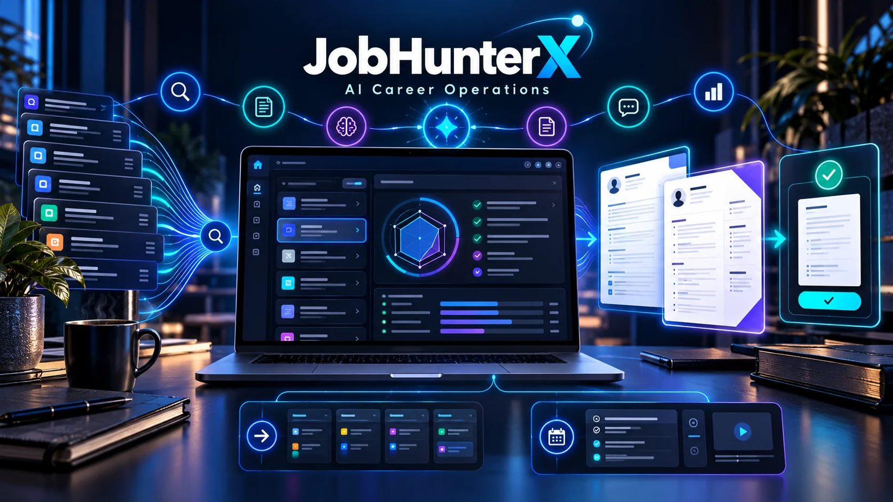

Illustrative concept — not a product screenshot or real data.

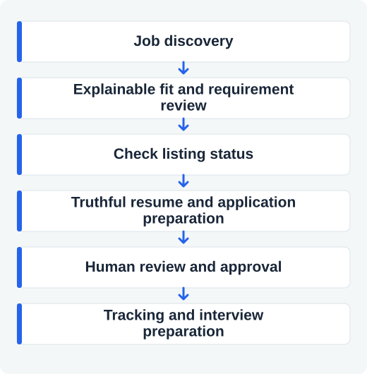

- Specialized agents coordinate discovery, matching, job liveness, application preparation and reporting.
- A Hebrew-first dashboard brings opportunities, approvals, application tracking and interview preparation together.
- Résumé content is grounded in candidate facts; there is no auto-apply, and Gmail sending is opt-in and approval-gated.
- **Technologies and interfaces:** Python, FastAPI, React, AI services, optional n8n and messaging integrations.
- **Status:** private independent project; production deployment and regression checks have been documented.

### APEX — Agentic business intelligence and operations

Business information often lives in separate systems. I conceived and built APEX around a practical question: how can a user ask in natural language and turn connected business data into a useful answer?

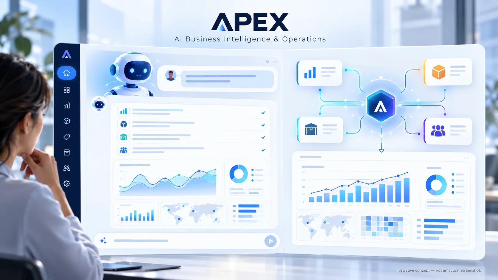

Illustrative concept — not a product screenshot or real data.

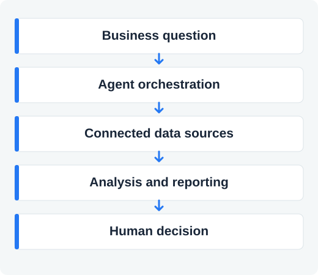

- Specialized agents, orchestration and integrations support analysis and reporting across systems.
- The work spans business discovery, product vision, requirements, solution design and AI-assisted development.
- **Technologies and interfaces:** Python, FastAPI, APIs, SOAP and MCP.
- **Status:** private project; this overview deliberately omits enterprise data and internal operational details.

### ThaiFamily Trip — AI-assisted family travel planning

Illustrative concept — not a product screenshot or real data.

I built a travel planner that brings itinerary design, place discovery, maps and practical tools into a Hebrew-first mobile experience. It is designed around family needs, travel pace and destination context.

The planning flow connects family preferences, destination information and AI-assisted itinerary generation, with a map-based way to explore places. The experience includes practical travel tools alongside the planner.

**Technologies and interfaces:** React, TypeScript, Leaflet, Supabase, OpenAI and n8n integrations. The project is private; this overview excludes personal itineraries and family information.

### WatchUp — Privacy-aware family alerts

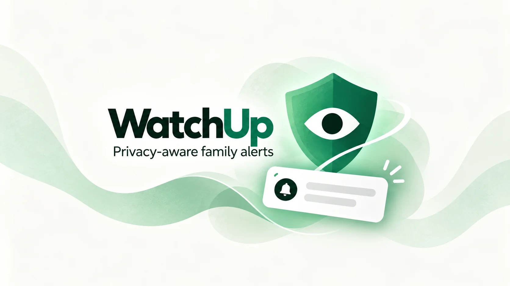

Illustrative concept — not a product screenshot or real data.

I built WatchUp to help parents notice selected communication alerts without reviewing every conversation. The documented experience includes a Hebrew dashboard, configurable alerts and a read-only integration that does not send or modify messages.

**Status:** private project. No family or message data is shown here.

### WebtopKids — School updates made simple

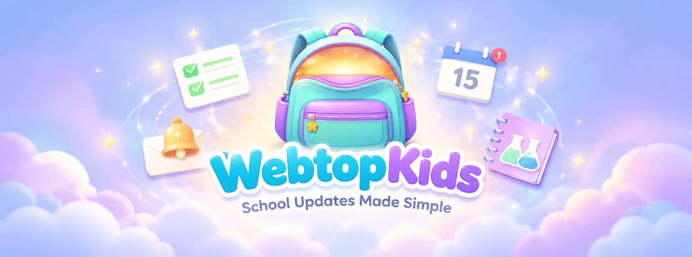

Illustrative concept — not a product screenshot or real data.

I built a family-oriented assistant to reduce repeated portal checking. It collects and organizes school updates, detects changes and supports Telegram notifications and reminders.

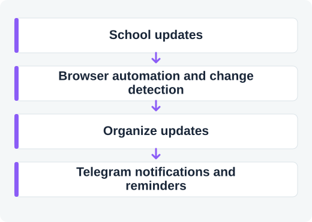

**Technologies and interfaces:** Node.js, Playwright, browser automation and Telegram. Private project; no student or school information is disclosed.

### Remind Me — Voice-first AI assistant

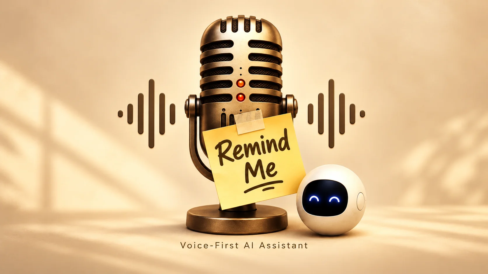

Illustrative concept — not a product screenshot or real data.

I built a voice-first assistant that transcribes spoken ideas, creates useful titles and helps organize them into workflows such as tasks, calendar events, email drafts or spreadsheet entries. It combines AI and Google integrations in a Hebrew-first mobile experience.

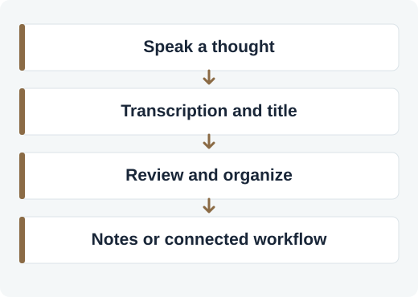

### Voice GmailBot — AI workspace assistant

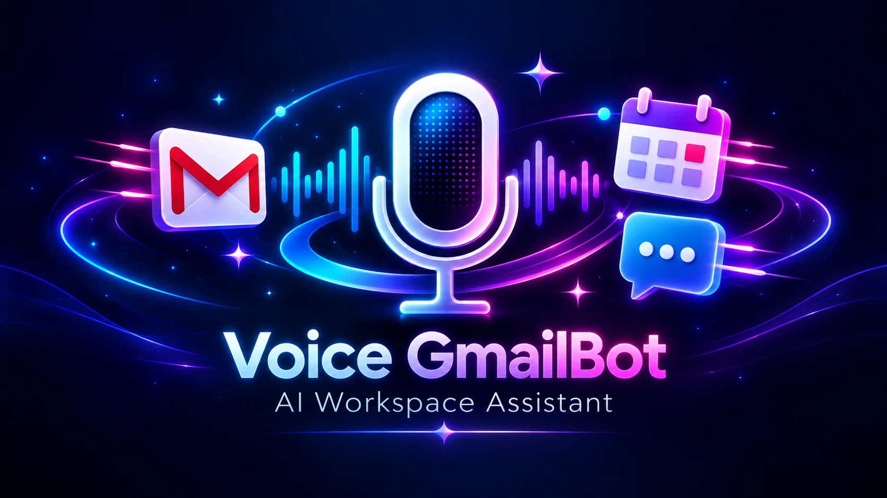

Illustrative concept — not a product screenshot or real data.

I built an assistant that connects productivity workflows through voice or natural language. It brings Gmail, Calendar, Contacts and Telegram together through n8n and MCP, supporting tasks such as drafting, scheduling and information retrieval. Connected actions depend on permissions and configuration, with user review where applicable.

### GiftWallet — Smart gift card management

Illustrative concept — not a product screenshot or real data.

I built a Hebrew-first app for organizing gift cards, combining image scanning, barcode validation and a dashboard, with optional cloud storage. Its documented stack includes React, TypeScript, OCR and optional Supabase.

### PRD Intake & Automation Brief — From business need to structured brief

Illustrative concept — not a product screenshot or real data.

A Hebrew-first intake workflow designed to turn an initial business request into a structured automation brief. A five-step form groups the problem, success criteria, requirements, inputs and outputs, integration needs, timing and supporting files. The implementation packages the submission as structured data with an RTL HTML requirements document for downstream workflow processing.

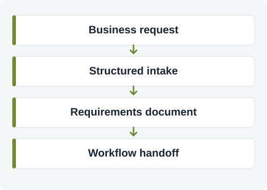

**Tools and interfaces:** React, TypeScript, Vite, React Hook Form, Zod, Supabase Edge Functions and n8n webhooks. This is a private prototype; integrations listed in its intake form are choices, not claims that each service is connected.

### ELDO — Personal AI agent in development

Illustrative concept — not a product screenshot or real data.

ELDO explores a personal assistant with structured memory, action policies, audit-oriented workflows and sandbox adapters. Live transport and deployment are still under development.

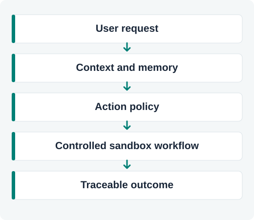

### DREAM TEAM — Agent work overview

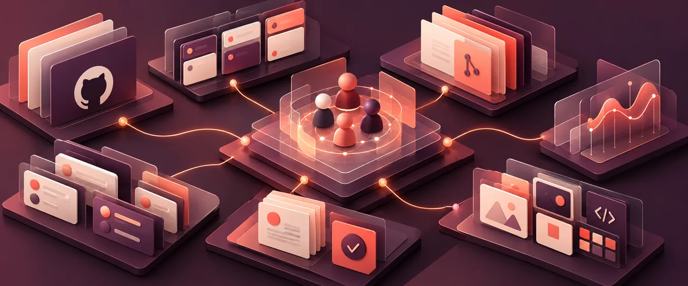

Illustrative concept — not a product screenshot or real data.

A private dashboard designed to bring project, task and agent activity together and make work that needs attention easier to find. It supports visibility; the dashboard alone does not demonstrate autonomous agent execution.

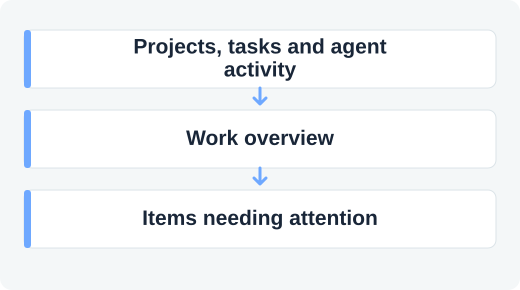

### EG Skills Core — AI work orchestration

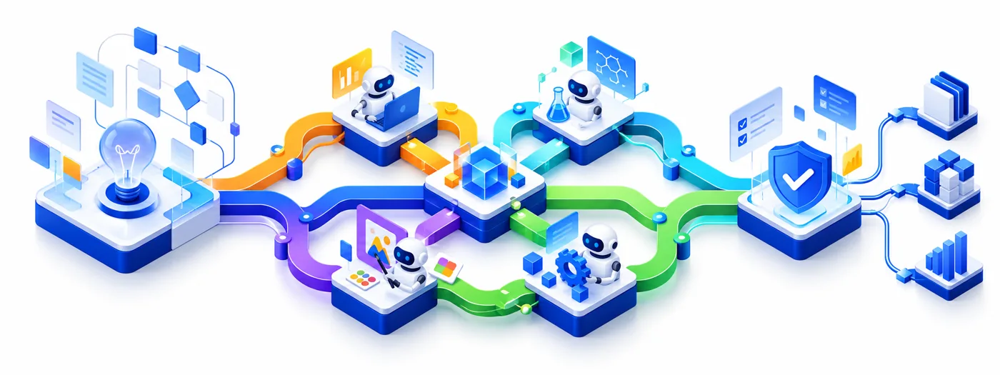

Illustrative concept — not a product screenshot or real data.

A private agent-work framework with reusable skills, specialist roles, orchestration, validation and continuity. Its documentation describes bounded task routing and separate review and validation responsibilities; behavior varies by configuration.

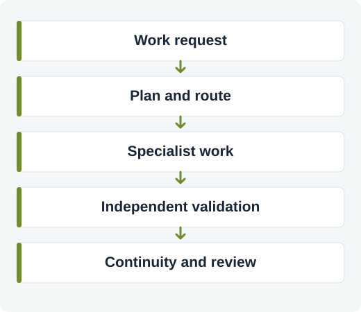

### New Project Tool — Project setup workflows

Illustrative concept — not a product screenshot or real data.

A private project setup toolkit containing project templates, specifications, setup scripts, tests and orchestration material. It reflects work on repeatable project foundations and structured AI-assisted development.

### More public code

- [TextBridge](https://github.com/eldadi9/TextBridge) — Hebrew–English AI translation, with plain text and Markdown-oriented workflows.
- [Fridge Chef](https://github.com/eldadi9/fridge-chef) — food and recipe workflows combining AI-related components and external data sources.
- [VoxScribe](https://github.com/eldadi9/VoxScribe) — early-stage transcription and meeting-summary project; planned features are not presented as finished.

## Tools and technologies

**AI:** AI agents · multi-agent orchestration · LLMs · prompt design · ChatGPT · Claude · Codex · Cursor

**Systems and integrations:** APIs · SOAP · webhooks · MCP · n8n · Python · FastAPI · React · TypeScript · SQL

**Product and delivery:** business analysis · system analysis · PRDs · roadmaps · user stories · E2E and regression testing · dashboards · KPIs

Tools listed here represent the breadth of my work across projects; they do not imply the same level of proficiency or use in every project.

---

### גם בעברית

אני מחבר בין הבנה עסקית, אפיון מערכות ובנייה מעשית של פתרונות AI. אני מתחיל בזיהוי הבעיה ובמיפוי האנשים, התהליכים והמידע, וממשיך לתכנון, בנייה, בדיקות ושיפור — תוך שמירה על בקרה אנושית במקומות המתאימים.

**תיק עבודות והדגמות:** חלק מהפרויקטים פרטיים; אפשר לתאם הדגמה שאינה חושפת מידע רגיש דרך [LinkedIn](https://www.linkedin.com/in/eldad-gonsherovitz-97153846/).

