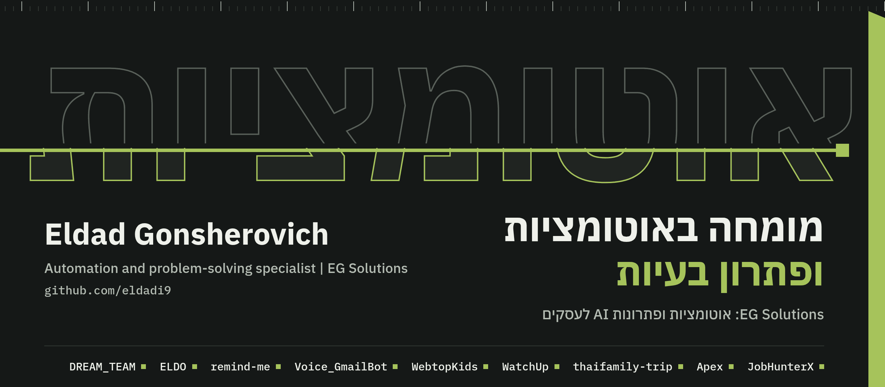
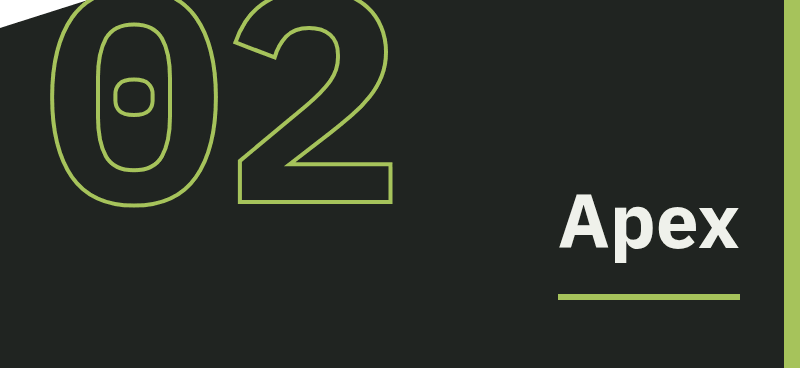
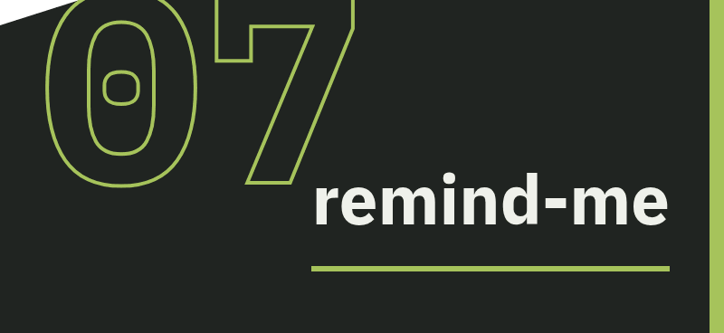
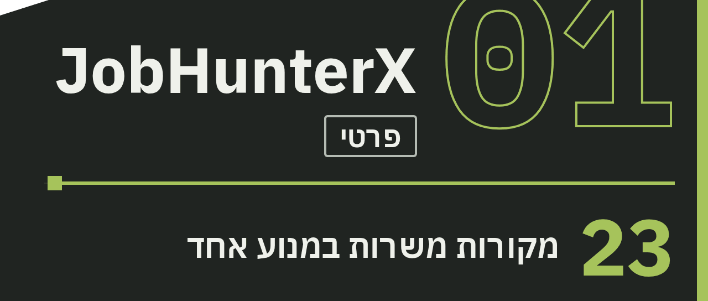
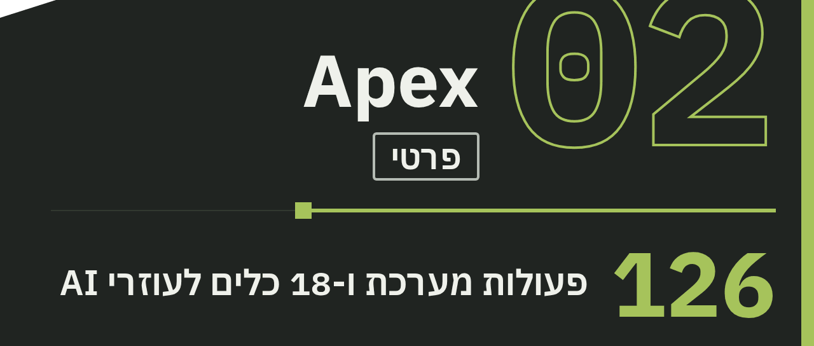
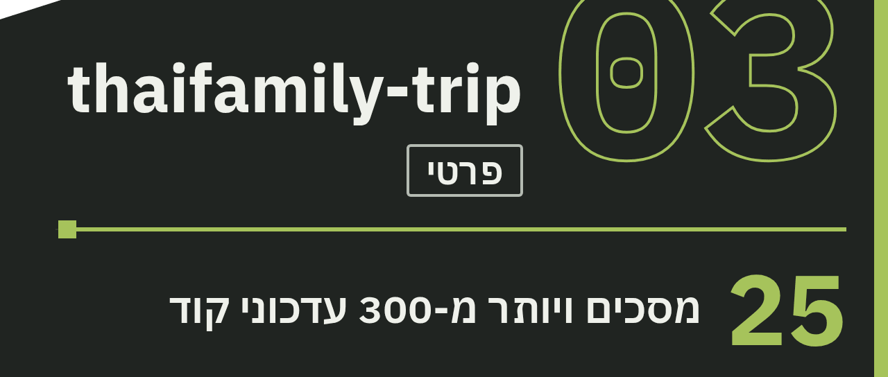
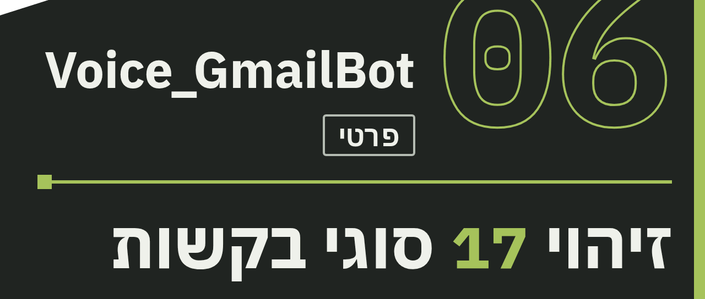
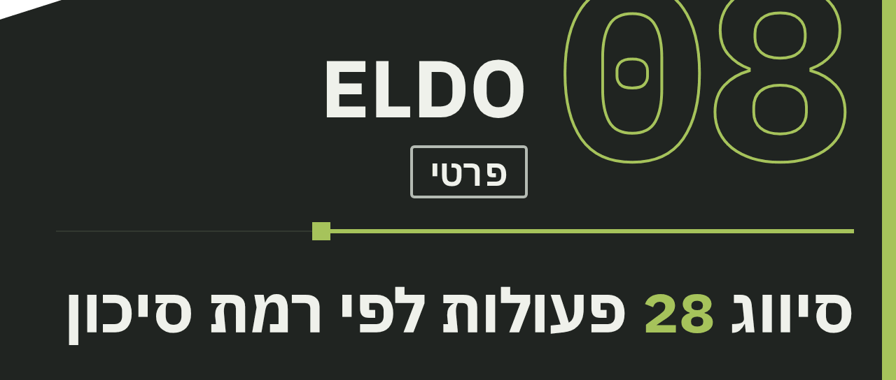
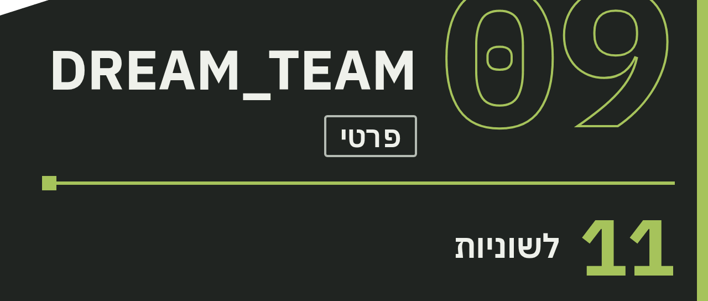

 

### [Explore the public project portfolio →](./PORTFOLIO.md)

Project stories, diagrams and technologies — with private repositories kept private.

# Eldad Gonsherovitz

### AI Solutions & Agentic Systems Lead

I turn complex business problems into practical AI solutions. I start by understanding the people, processes, data and decisions behind a problem, then translate that understanding into requirements and a working solution.

I bring 20+ years of business and operational leadership, technical project delivery, and hands-on AI exploration and building since early 2023. At Verifone Israel, I lead implementation work across business and technical stakeholders. In parallel, I conceive and build AI products and connected workflows using AI-assisted development.

**What I bring**

- **Business and systems analysis:** process mapping, discovery, PRDs, requirements and acceptance criteria.
- **Agentic systems:** AI agents, multi-agent orchestration, LLM workflows, validation and human approval.
- **Integrations and automation:** APIs, SOAP, webhooks, MCP and n8n.
- **Technical delivery:** roadmaps, milestones, stakeholder coordination, testing and implementation.
- **Measurement and improvement:** dashboards, reporting, monitoring and iteration.

**Selected work:** JobHunterX is an independent, production-verified multi-agent career operations system. APEX is an agentic business intelligence and operations solution I conceived and built to connect enterprise data and support natural-language questions and reporting. Both repositories are private; public descriptions are limited to non-confidential capabilities.

[LinkedIn](https://www.linkedin.com/in/eldad-gonsherovitz-97153846/) · Project demonstrations available on request

**לתיאורי פרויקטים מעודכנים:** [תיק העבודות המלא](./PORTFOLIO.md). המאגרים הפרטיים נשארים פרטיים.

# אלדד גונשרוביץ'

**מומחה באוטומציות ופתרון בעיות | EG Solutions**

אני בונה סוכני AI שעושים עבודה אמיתית, ויודעים מתי לעצור ולשאול.

שנים של ניהול ותפעול עסקי, לוגיסטיקה וכספים. היום אני בונה בעצמי סוכני AI ואוטומציות שפותרים בעיות אמיתיות.

סורק לפני שבונה, מתכנן לפני שמבצע, ודורש הוכחה לכל טענה. וכשסוכן פועל בשמי, הוא עוצר ושואל לפני כל צעד שיוצא החוצה.

 

 

### 

**מנוע התאמת משרות אוטונומי: סורק את השוק, מדרג, מכין מועמדות ומלווה עד הראיון.**

####  הבעיה

מועמד רציני מבזבז את רוב הזמן על סינון: עשרות לוחות ומערכות גיוס, משרות שנסגרו מזמן אבל עדיין מופיעות, קורות חיים שצריך להתאים לכל משרה, ומעקב ידני אחרי כל מועמדות. ההחלטות שבאמת חשובות נדחקות לסוף היום.

####  מה המערכת עושה

<table>
<tr>
<td width="72" valign="top" align="center">

</td>
<td valign="top">

סורקת מקורות משרות מוגדרים, ממערכות גיוס בעולם ועד לוחות בישראל.

</td>
</tr>
<tr>
<td width="72" valign="top" align="center">

</td>
<td valign="top">

מסננת כפילויות, מדרגת התאמה ובודקת שהמשרה עדיין פתוחה.

</td>
</tr>
<tr>
<td width="72" valign="top" align="center">

</td>
<td valign="top">

מתאימה קורות חיים, כותבת מכתב מקדים ומכינה את המועמדות.

</td>
</tr>
<tr>
<td width="72" valign="top" align="center">

</td>
<td valign="top">

עוצרת לאישור אנושי. שום מועמדות לא יוצאת בלי אישור.

</td>
</tr>
<tr>
<td width="72" valign="top" align="center">

</td>
<td valign="top">

עוקבת אחרי כל מועמדות, ומכינה חבילה ותרגול לראיון.

</td>
</tr>
</table>

####  יכולות

<table>
<tr>
<td width="50%" valign="top">

 מקורות משרות מגוונים במנוע אחד

</td>
<td width="50%" valign="top">

 דירוג התאמה בעברית ובאנגלית, עם הסבר לכל ציון

</td>
</tr>
<tr>
<td width="50%" valign="top">

 שופט AI מכייל עד ±15. בלי דרישת חובה, אין התאמה

</td>
<td width="50%" valign="top">

 זיהוי משרות שכבר נסגרו

</td>
</tr>
<tr>
<td width="50%" valign="top">

 התאמת קורות חיים ומכתב לכל משרה

</td>
<td width="50%" valign="top">

 תור אישורים לפני כל שליחה

</td>
</tr>
<tr>
<td width="50%" valign="top">

 מעקב סטטוס מלא, מהגשה ועד הצעה

</td>
<td width="50%" valign="top">

 הכנה לראיון וסימולציית ראיון

</td>
</tr>
</table>

####  מה מייחד

השליטה בעלות מובנית: ה-AI מופעל רק על משרות שהציון שלהן גבולי, ויש תקרה לכל סריקה. והאדם נשאר בשליטה מלאה: המערכת מכינה הכול, אבל לא שולחת לבד.

####  איפה זה עומד

מערכת רחבה שפותחה באופן מתמשך, עם יומן שגיאות ותהליכי בדיקה ובקרה.

### 

**מערכת BI ותפעול מבוססת סוכנים: שואלים בעברית ומקבלים תובנות ממקורות נתונים מחוברים.**

####  הבעיה

בארגונים רבים הנתונים יושבים במערכות ישנות וחדשות שלא מדברות זו עם זו. כדי לענות על שאלה תפעולית פשוטה צריך לשלוף מכמה מקומות, להצליב ידנית ולבנות דוח. התשובה מגיעה מאוחר, ולפעמים לא מגיעה בכלל.

####  מה המערכת עושה

<table>
<tr>
<td width="72" valign="top" align="center">

</td>
<td valign="top">

מאחדת כמה מקורות נתונים, ישנים וחדשים, לתמונה אחת.

</td>
</tr>
<tr>
<td width="72" valign="top" align="center">

</td>
<td valign="top">

מקבלת שאלה חופשית בעברית, וסוכן מתכנן לבד את הצעדים.

</td>
</tr>
<tr>
<td width="72" valign="top" align="center">

</td>
<td valign="top">

סוכנים ייעודיים שולפים, מנתחים ומפעילים חוקים עסקיים.

</td>
</tr>
<tr>
<td width="72" valign="top" align="center">

</td>
<td valign="top">

מחזירה דוח, מצגת, קובץ Excel או התראה מתוזמנת.

</td>
</tr>
</table>

####  יכולות

<table>
<tr>
<td width="50%" valign="top">

 שאלות חופשיות בעברית

</td>
<td width="50%" valign="top">

 מנוע המנתב בקשות למשימות ולסוכנים מתאימים

</td>
</tr>
<tr>
<td width="50%" valign="top">

 7 דוחות מובנים, ודוחות דינמיים לפי בקשה

</td>
<td width="50%" valign="top">

 הפקת מצגות וקובצי Excel אוטומטית

</td>
</tr>
<tr>
<td width="50%" valign="top">

 התראות מתוזמנות לטלגרם ולמייל

</td>
<td width="50%" valign="top">

 מחולל תוויות והדפסה, כולל QR

</td>
</tr>
<tr>
<td width="50%" valign="top">

 חיבור לעוזרי AI באמצעות כלי MCP

</td>
<td width="50%" valign="top">

 בקרת בריאות עם תיקון אוטומטי

</td>
</tr>
</table>

####  מה מייחד

שאלה אחת בעברית מחליפה שליפה ידנית מכמה מערכות. אותה מערכת עונה על השאלה, מפיקה את הדוח ושולחת את ההתראה.

####  איפה זה עומד

מערכת רחבה עם ממשקים, כלי AI ודוחות; היכולות משתנות בהתאם לתצורה ולשלב הפרויקט.

### 

**מתכנן טיולים משפחתי מבוסס AI, שמתאים את המסלול לגילאי הילדים, לשעות השינה ולעגלה.**

####  הבעיה

תכנון טיול משפחתי לחו"ל מתפזר בין עשרות אתרים, קבוצות וקבצים. כלי תכנון רגילים לא יודעים שיש בבית ילדים קטנים, שהעגלה לא עולה בכל שביל, ושיום עמוס מדי נגמר בבכי. והכול באנגלית.

####  מה המערכת עושה

<table>
<tr>
<td width="72" valign="top" align="center">

</td>
<td valign="top">

המשפחה מגדירה יעד, תאריכים, קצב טיול וגילאי הילדים.

</td>
</tr>
<tr>
<td width="72" valign="top" align="center">

</td>
<td valign="top">

ה-AI בונה מסלול יומי לפי שעות שינה, עגלה וקצב המשפחה.

</td>
</tr>
<tr>
<td width="72" valign="top" align="center">

</td>
<td valign="top">

מקומות אמיתיים מ-Google Places וממפות פתוחות, על מפה ועם המלצות לערב.

</td>
</tr>
<tr>
<td width="72" valign="top" align="center">

</td>
<td valign="top">

סוכן בוואטסאפ עונה למשפחה, מציע פעולות ומחכה לאישור.

</td>
</tr>
</table>

####  יכולות

<table>
<tr>
<td width="50%" valign="top">

 מסלול יומי שנבנה לפי גילאי הילדים

</td>
<td width="50%" valign="top">

 רגישות לשעות שינה ולעגלה

</td>
</tr>
<tr>
<td width="50%" valign="top">

 מקומות אמיתיים עם הכוונה מנמל או משדה

</td>
<td width="50%" valign="top">

 מפה אינטראקטיבית

</td>
</tr>
<tr>
<td width="50%" valign="top">

 השוואת מלונות, תרגום ומסמכים

</td>
<td width="50%" valign="top">

 רשימת אריזה במקום אחד

</td>
</tr>
<tr>
<td width="50%" valign="top">

 סוכן משפחתי בקבוצת הוואטסאפ

</td>
<td width="50%" valign="top">

 הבנת הודעות קוליות בקבוצה

</td>
</tr>
</table>

####  מה מייחד

זה לא עוד אתר טיולים: הסוכן חי בתוך קבוצת הוואטסאפ של המשפחה, עונה רק כשפונים אליו בשם, ולא מבצע שום שינוי בלי אישור. ובעברית מההתחלה ועד הסוף.

####  איפה זה עומד

מוצר רחב: 25 מסכים ויותר מ-300 עדכוני קוד, עם מסלול דגל בתאילנד.

### 

**שקט נפשי להורים, בלי לקרוא את השיחות של הילד.**

####  הבעיה

הורים רוצים לדעת כשמשהו לא בסדר בוואטסאפ של הילד: מספר זר, מילה מדאיגה או קבוצה חדשה. אבל לקרוא כל שיחה זה לא פרקטי, וגם פוגע באמון. האפשרות הנוכחית היא לראות הכול, או לא לראות כלום.

####  מה המערכת עושה

<table>
<tr>
<td width="72" valign="top" align="center">

</td>
<td valign="top">

ההורה מחבר את חשבון הילד בסריקת קוד.

</td>
</tr>
<tr>
<td width="72" valign="top" align="center">

</td>
<td valign="top">

המערכת מזהה רק חריגים שההורה הגדיר מראש.

</td>
</tr>
<tr>
<td width="72" valign="top" align="center">

</td>
<td valign="top">

ההורה רואה דשבורד בעברית עם החריגים בלבד.

</td>
</tr>
</table>

####  יכולות

<table>
<tr>
<td width="50%" valign="top">

 התראה על מספר לא מזוהה

</td>
<td width="50%" valign="top">

 מילות מעקב שההורה מגדיר

</td>
</tr>
<tr>
<td width="50%" valign="top">

 זיהוי קבוצות חדשות ושינויים בחברות

</td>
<td width="50%" valign="top">

 לוח זמנים לניטור לפי יום

</td>
</tr>
<tr>
<td width="50%" valign="top">

 דשבורד הורים בעברית

</td>
<td width="50%" valign="top">

 כמה ילדים במשפחה אחת, לכל אחד פרופיל משלו

</td>
</tr>
<tr>
<td width="50%" valign="top">

 יומן פעולות להורה

</td>
<td width="50%" valign="top">

 מחיקת כל נתוני המשפחה לפי בקשה

</td>
</tr>
</table>

####  מה מייחד

העיקרון הוא מינימום חשיפה: ההורה רואה רק את החריגים שהוא ביקש לראות, ולא את כל השיחות.

####  איפה זה עומד

אב-טיפוס. התשתית לכמה משקי בית כבר קיימת, והפתיחה למשתמשים נוספים בתכנון.

### 

**המידע מגיע למשפחה, במקום שהמשפחה תרדוף אחריו.**

####  הבעיה

משימות, מועדי הגשה והודעות חשובות יושבים במערכת מקוונת פסיבית. כדי לדעת מה חדש צריך להיכנס, לחפש ולזכור לבדוק שוב. מה שלא נבדק בזמן מתגלה מאוחר מדי.

####  מה המערכת עושה

<table>
<tr>
<td width="72" valign="top" align="center">

</td>
<td valign="top">

בודקת את המקור אוטומטית כל 15 דקות.

</td>
</tr>
<tr>
<td width="72" valign="top" align="center">

</td>
<td valign="top">

מפרידה את המידע לפי בן משפחה ומסננת כפילויות וישן.

</td>
</tr>
<tr>
<td width="72" valign="top" align="center">

</td>
<td valign="top">

שולחת התראה מיידית בטלגרם רק על מה שבאמת חדש.

</td>
</tr>
<tr>
<td width="72" valign="top" align="center">

</td>
<td valign="top">

מזכירה לפני מועד הגשה, ומפסיקה כשהמשימה סומנה כבוצעה.

</td>
</tr>
</table>

####  יכולות

<table>
<tr>
<td width="50%" valign="top">

 8 סוגי התראות מיידיות

</td>
<td width="50%" valign="top">

 תזכורות מדורגות לפני כל מועד הגשה

</td>
</tr>
<tr>
<td width="50%" valign="top">

 סימון «בוצע» שעוצר את התזכורות

</td>
<td width="50%" valign="top">

 בלי כפילויות, גם אחרי הפעלה מחדש

</td>
</tr>
<tr>
<td width="50%" valign="top">

 שעות שקט בין 21:00 ל-07:00

</td>
<td width="50%" valign="top">

 דשבורד עם 9 לשוניות

</td>
</tr>
<tr>
<td width="50%" valign="top">

 תובנות שבועיות ומגמות

</td>
<td width="50%" valign="top">

 בוט טלגרם עם פקודות מהירות

</td>
</tr>
</table>

####  מה מייחד

מערכת שיודעת מתי לדבר ומתי לשתוק. היא שולחת רק את מה שחדש ורלוונטי לכל בן משפחה, ומכבדת את שעות הלילה.

####  איפה זה עומד

מערכת עם דשבורד ובוט טלגרם, שנבנתה לשימוש המשפחה.

### 

**עוזר אישי בקול, בעברית: מייל, יומן ואנשי קשר בהודעה אחת.**

####  הבעיה

ניהול מייל ויומן דורש מסך, מקלדת וזמן. בדרך, בנהיגה או בין פגישות זה פשוט לא קורה. ורוב העוזרים הקוליים לא באמת מבינים עברית.

####  מה המערכת עושה

<table>
<tr>
<td width="72" valign="top" align="center">

</td>
<td valign="top">

שולחים לבוט בטלגרם הודעה קולית או כתובה, או מדברים באפליקציה.

</td>
</tr>
<tr>
<td width="72" valign="top" align="center">

</td>
<td valign="top">

ההודעה מתומללת, וסוכן AI מבין מה המשתמש רוצה.

</td>
</tr>
<tr>
<td width="72" valign="top" align="center">

</td>
<td valign="top">

הסוכן קורא, מחפש ומסכם ב-Gmail, ביומן ובאנשי הקשר.

</td>
</tr>
<tr>
<td width="72" valign="top" align="center">

</td>
<td valign="top">

הסוכן מציע פעולה או יוצר אירוע. במייל: סגנון, תצוגה מקדימה ואישור.

</td>
</tr>
</table>

####  יכולות

<table>
<tr>
<td width="50%" valign="top">

 הודעות קוליות בעברית, מתומללות אוטומטית

</td>
<td width="50%" valign="top">

 סיכום וחיפוש במייל

</td>
</tr>
<tr>
<td width="50%" valign="top">

 יצירה, עדכון וביטול אירועים ביומן

</td>
<td width="50%" valign="top">

 חיפוש וניהול של אנשי קשר ומשימות, עם אישור

</td>
</tr>
<tr>
<td width="50%" valign="top">

 כתיבת מייל ב-9 סגנונות

</td>
<td width="50%" valign="top">

 הבנת תאריכים בעברית, כמו «מחר»

</td>
</tr>
<tr>
<td width="50%" valign="top">

 זיהוי 17 סוגי בקשות

</td>
<td width="50%" valign="top">

 דוח בדיקת מערכת מובנה

</td>
</tr>
</table>

####  מה מייחד

עברית אמיתית, לא תרגום: הבוט מבין תאריכים, שמות חודשים וניסוחים יומיומיים בעברית, ומקבל גם הודעות קוליות וגם טקסט.

####  איפה זה עומד

בוט טלגרם ואפליקציית ווב שמחוברים לאותו סוכן.

### 

**אומרים מחשבה בקול, והיא הופכת לפעולה.**

####  הבעיה

הרעיונות החשובים מגיעים בדיוק כשאין זמן להקליד: בנהיגה, בהליכה, באמצע יום עמוס. פתק קולי נשכח בטלפון, ומשימה שלא נרשמה לא קורית.

####  מה המערכת עושה

<table>
<tr>
<td width="72" valign="top" align="center">

</td>
<td valign="top">

לוחצים ומקליטים מחשבה בעברית.

</td>
</tr>
<tr>
<td width="72" valign="top" align="center">

</td>
<td valign="top">

ההקלטה מתומללת מילה במילה בצד השרת, ומקבלת כותרת.

</td>
</tr>
<tr>
<td width="72" valign="top" align="center">

</td>
<td valign="top">

ה-AI מזהה אם זה אירוע, משימה, מייל או שורה בגיליון.

</td>
</tr>
<tr>
<td width="72" valign="top" align="center">

</td>
<td valign="top">

נפתח טופס מוכן לאירוע, למשימה, למייל או לשורה בגיליון, לעריכה ולאישור.

</td>
</tr>
</table>

####  יכולות

<table>
<tr>
<td width="50%" valign="top">

 הקלטה בלחיצה אחת

</td>
<td width="50%" valign="top">

 תמלול בעברית, ששומר מונחים באנגלית

</td>
</tr>
<tr>
<td width="50%" valign="top">

 זיהוי אוטומטי של 6 סוגי כוונות

</td>
<td width="50%" valign="top">

 אירוע חדש ביומן

</td>
</tr>
<tr>
<td width="50%" valign="top">

 משימה חדשה בלחיצה

</td>
<td width="50%" valign="top">

 טיוטת מייל מוכנה

</td>
</tr>
<tr>
<td width="50%" valign="top">

 שורה בגיליון אישי, וייצוא ל-Excel

</td>
<td width="50%" valign="top">

 ניווט ב-Waze ישירות מהפתק

</td>
</tr>
</table>

####  מה מייחד

המרחק בין מחשבה לפעולה מתקצר להקלטה אחת. המשתמש רק מדבר, והמערכת מבינה לבד מה לעשות עם הפתק.

####  איפה זה עומד

אפליקציה שמותקנת בטלפון כמו אפליקציה רגילה. שליחה גם לוואטסאפ נמצאת בתכנון.

### 

**סוכן AI אישי שנבנה מהיסוד כדי שאפשר יהיה לסמוך עליו.**

####  הבעיה

סוכן AI שפועל בשמך יכול לשלוח הודעה לאדם הלא נכון, לבצע פעולה שלא ביקשת, או להיות מופעל על ידי טקסט זדוני במייל או בדף אינטרנט. רוב הסוכנים בונים קודם יכולות, ורק אחר כך חושבים על בקרה.

####  מה המערכת עושה

<table>
<tr>
<td width="72" valign="top" align="center">

</td>
<td valign="top">

מקבלת פקודה מהבעלים בלבד, ומוודאת שהיא באמת ממנו.

</td>
</tr>
<tr>
<td width="72" valign="top" align="center">

</td>
<td valign="top">

מסווגת כל פעולה לירוקה, צהובה או אדומה.

</td>
</tr>
<tr>
<td width="72" valign="top" align="center">

</td>
<td valign="top">

פעולה רגישה ממתינה לאישור חד-פעמי מפורש.

</td>
</tr>
<tr>
<td width="72" valign="top" align="center">

</td>
<td valign="top">

ההודעה עוברת 8 שלבי בקרה ונרשמת ביומן ביקורת לפני שליחה.

</td>
</tr>
</table>

####  יכולות

<table>
<tr>
<td width="50%" valign="top">

 סיווג 28 פעולות לפי רמת סיכון

</td>
<td width="50%" valign="top">

 פעולה לא מוכרת נחסמת אוטומטית

</td>
</tr>
<tr>
<td width="50%" valign="top">

 סדרת תנאי עצירה לפני כל שליחה

</td>
<td width="50%" valign="top">

 דחיית ניסיונות להשתלט על הסוכן מבחוץ

</td>
</tr>
<tr>
<td width="50%" valign="top">

 אישורים חד-פעמיים עם תוקף

</td>
<td width="50%" valign="top">

 «אין רישום, אין שליחה»

</td>
</tr>
<tr>
<td width="50%" valign="top">

 מתג עצירה מיידי ומפסק אוטומטי

</td>
<td width="50%" valign="top">

 הגבלת קצב שליחה לשעה וליום

</td>
</tr>
</table>

####  מה מייחד

זה סוכן שנבנה קודם כול כדי לא לטעות. אישור שמגיע ממייל, מדף אינטרנט או מטקסט אחר נדחה, ורק הבעלים יכול לאשר.

####  איפה זה עומד

בפיתוח, בסביבה מבודדת, ועדיין לא שירות חי. חיבור לערוצים חיים כמו הודעות, SMS וקול נמצא בתכנון.

### 

**חדר הבקרה של צוות סוכני ה-AI שלי.**

####  הבעיה

כשכמה סוכני AI עובדים במקביל על כמה פרויקטים, קשה לדעת מה קורה עכשיו, מה תקוע ומה מחכה להחלטה. העדכונים מתפזרים בין שיחות, קבצים ושרתים.

####  מה המערכת עושה

<table>
<tr>
<td width="72" valign="top" align="center">

</td>
<td valign="top">

מרכזת במסך אחד את המשימות, הסוכנים, הפרויקטים ומצב השרת.

</td>
</tr>
<tr>
<td width="72" valign="top" align="center">

</td>
<td valign="top">

מתעדכנת בזמן אמת, ומראה אם התצוגה מסונכרנת.

</td>
</tr>
<tr>
<td width="72" valign="top" align="center">

</td>
<td valign="top">

מציגה קודם את מה שמחכה להחלטה שלי, לפי עדיפות.

</td>
</tr>
</table>

####  יכולות

<table>
<tr>
<td width="50%" valign="top">

 מסך «מה מחכה לך» לפי עדיפות

</td>
<td width="50%" valign="top">

 מטריצת פרויקטים וסטטוס עם צלילה לפרטים

</td>
</tr>
<tr>
<td width="50%" valign="top">

 טבלת משימות עם מיון, חיפוש וסינון

</td>
<td width="50%" valign="top">

 מסכי סוכנים ותחומי אחריות

</td>
</tr>
<tr>
<td width="50%" valign="top">

 יומן פעילות עם סינון

</td>
<td width="50%" valign="top">

 מעקב מכסה שבועית עד האיפוס

</td>
</tr>
<tr>
<td width="50%" valign="top">

 עדכונים חיים עם תווית סנכרון

</td>
<td width="50%" valign="top">

 מותקן בטלפון כמו אפליקציה

</td>
</tr>
</table>

####  מה מייחד

מסך אחד שבו רואים בבת אחת את כל העבודה של צוות סוכני ה-AI, ויודעים מה מחכה להחלטה שלי.

####  איפה זה עומד

לוח שמותקן בטלפון, עם 11 לשוניות.

ועוד עשרות ריפו.

**ליצירת קשר:** [LinkedIn](https://www.linkedin.com/in/eldad-gonsherovitz-97153846/)

